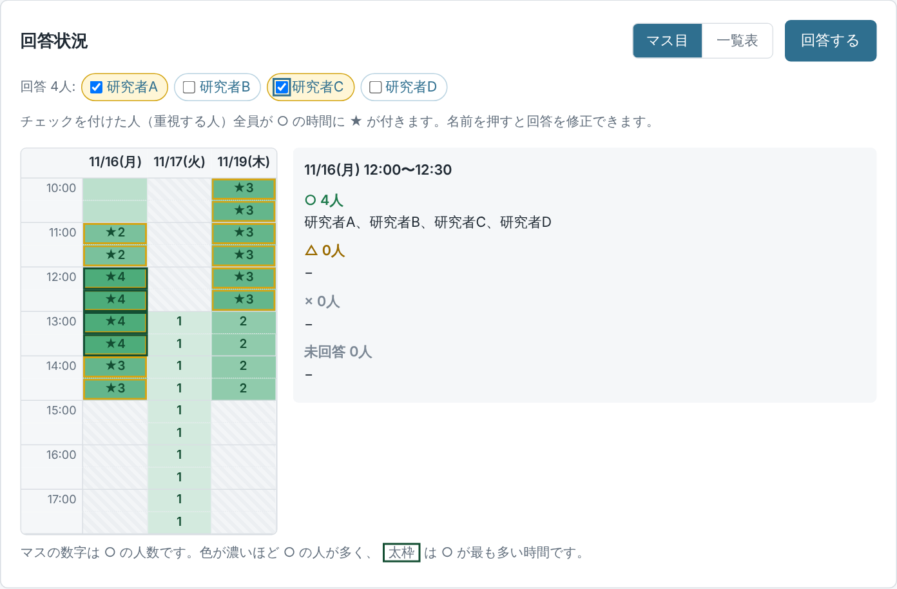
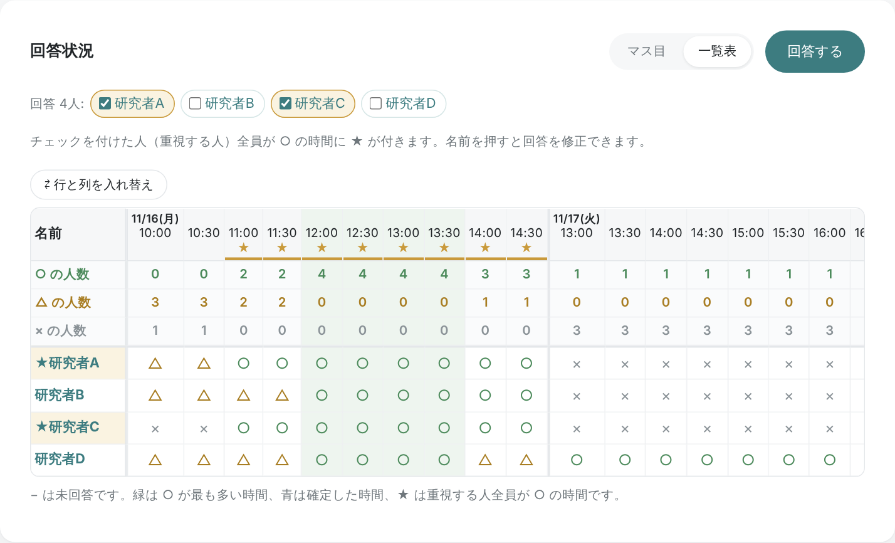
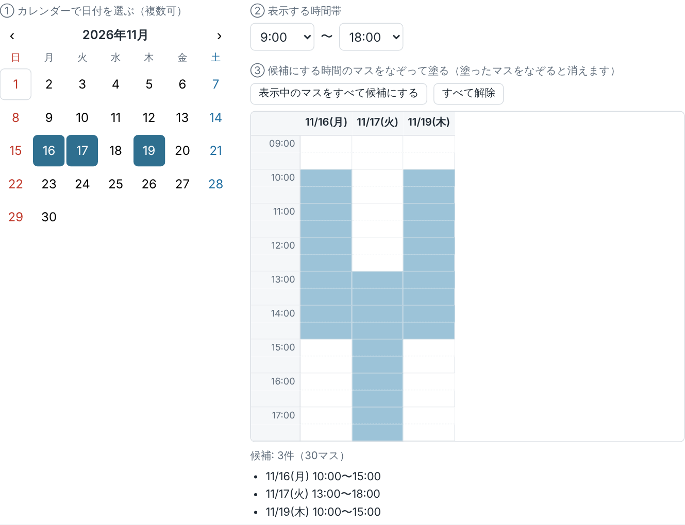
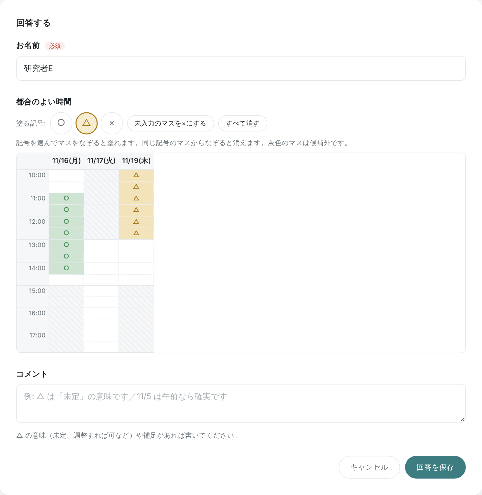

# tokatonton

30 分刻みのマス目をなぞって、細かく日程を調整できる予定調整 Web アプリです。
共同研究者との打ち合わせなど、少人数の日程調整を想定しています。

- 幹事は日付を選び、マス目をなぞって候補の時間を塗るだけ
- 参加者は ○ / △ / × を選んでマス目をなぞり、都合を細かく入力（ログイン不要）
- 回答状況は「マス目」と「一覧表」で確認。重視する人を選ぶと、その全員が ○ の時間に ★ が付く
- 幹事はマス目をなぞって日程を確定（例: 11/16 12:00〜13:30）

画面は GitHub Pages、データは自分の Google スプレッドシートに保存します。
サーバーの契約や費用は不要で、ビルドや外部ライブラリも使っていません（HTML / CSS / JavaScript のみ）。

## 画面の例

| 回答状況（マス目） | 回答状況（一覧表） |
| --- | --- |
|  |  |

| 候補の時間を選ぶ（幹事） | 回答する（参加者） |
| --- | --- |
|  |  |

## 使い方

### 幹事

1. トップページでタイトル・説明・回答締切日（任意）を入れます。
2. 候補の時間を選びます。
   1. カレンダーで日付を選ぶ（複数可）
   2. 表示する時間帯を選ぶ（例: 9:00〜18:00）
   3. 候補にしたいマスをなぞって塗る（塗ったマスからなぞると消えます）
3. 合言葉を入れて「イベントを作成」を押すと、2 つの URL が表示されます。
   - **参加者に送る URL**: 参加者にメールなどで送ります。
   - **幹事用 URL**: 自分だけが持っておきます。**なくすと再発行できません。**
     （作成したブラウザでは、トップページの「このブラウザで作成したイベント」から開けます）
4. 回答が集まったら、幹事用 URL を開いて「日程を確定する」を押し、
   回答状況のマス目で確定する時間を同じ日の中でなぞって選びます。
5. 幹事用 URL からは、イベントの編集・回答の削除・イベントの削除もできます。
   調整が終わったイベントは削除しておくと安心です。

### 参加者

1. 届いた URL を開いて「回答する」を押します。
2. 名前を入れ、塗る記号（○ / △ / ×）を選んでマス目をなぞります。
   - ○ / △ / × の意味はあえて決めていません。
     △ が「未定」なのか「調整すれば可」なのかなどは、コメント欄で補足してください。
3. 「回答を保存」を押します。あとから自分の名前を押すと修正できます。

### 回答状況の見方

- **マス目**: ○ の人が多い時間ほど濃い緑になり、マスの数字は ○ の人数です。
  マスにカーソルを乗せる（スマホではタップする）と、その時間に ○ / △ / × を付けた人がわかります。
- **一覧表**: 参加者ごとに、すべての時間の ○ / △ / × を一覧できます。「⇄ 行と列を入れ替え」で向きを変えられます。
- **重視する人**: 名前の横のチェックを付けると、チェックした人全員が ○ の時間に ★ が付きます
  （自分の画面での表示だけで、保存はされません）。

## 自分で構築する

このリポジトリをコピーして、自分専用の tokatonton を作れます。
必要なのは **GitHub アカウント（無料）** と **個人の Google アカウント** だけです。

> 所属機関の Google Workspace アカウントは、組織外の人がアクセスできない設定になっていることがあるので、
> 個人の Google アカウントをおすすめします。

### 1. リポジトリをフォークする

GitHub でこのリポジトリを開き、右上の「Fork」を押して自分のアカウントにコピーします。

### 2. スプレッドシートと Apps Script を用意する

1. Google ドライブで新しいスプレッドシートを作ります（名前は例えば「tokatonton-data」）。
   - このスプレッドシートは **誰とも共有する必要はありません。**
2. メニューの「拡張機能」→「Apps Script」を開きます。
3. 最初から入っている `function myFunction() { ... }` を消し、
   [`gas/Code.gs`](gas/Code.gs) の内容をすべて貼り付けて保存（Ctrl+S / ⌘+S）します。
   - 左上のプロジェクト名は「tokatonton」などに変えておくとわかりやすいです。

### 3. ウェブアプリとしてデプロイする

1. Apps Script の画面右上の「デプロイ」→「新しいデプロイ」を押します。
2. 「種類の選択」の ⚙ から **「ウェブアプリ」** を選び、次のように設定します。
   - 次のユーザーとして実行: **自分**
   - アクセスできるユーザー: **全員**
3. 「デプロイ」を押すと、アクセスの承認を求められます。
   1. 「アクセスを承認」→ 自分のアカウントを選びます。
   2. 「このアプリは Google で確認されていません」と出たら、「詳細」→「（プロジェクト名）（安全ではないページ）に移動」を押します。
      （自分で作ったスクリプトなので Google の審査を受けていない、という意味です）
   3. 「Google スプレッドシートのうち、このアプリケーションがインストールされているもの」への
      アクセスを求められるので「許可」を押します。
      （このスクリプトは、このスプレッドシート以外にはアクセスできません）
4. 表示された **ウェブアプリの URL**（`https://script.google.com/macros/s/.../exec`）をコピーします。
   - ブラウザでこの URL を開き、「tokatonton のサーバーは動作しています」と出れば OK です。

### 4. 接続設定を書き換える

フォークした自分のリポジトリで [`docs/js/config.js`](docs/js/config.js) を開き（GitHub の画面の ✏ で編集できます）、
`GAS_URL` を **自分の** ウェブアプリの URL に書き換えて保存（Commit）します。

```js
export const GAS_URL = "https://script.google.com/macros/s/XXXXXXXX/exec";
```

> **必ず書き換えてください。** 書き換えないと、元のリポジトリの持ち主のサーバーにつながってしまい、
> 合言葉が分からないのでイベントを作れません。

### 5. GitHub Pages で公開する

1. 自分のリポジトリの「Settings」→「Pages」を開きます。
2. 「Build and deployment」の Source を「Deploy from a branch」にし、
   Branch を `main`、フォルダを `/docs` にして「Save」を押します。
3. 1〜2 分待つと `https://<ユーザー名>.github.io/tokatonton/` で公開されます。

> 無料プランの GitHub では、GitHub Pages を使うにはリポジトリを **Public** にする必要があります。
> 公開されるのはコードだけで、予定のデータ（スプレッドシート）は公開されません。

### 6. イベント作成用の合言葉を設定する（おすすめ）

合言葉を設定すると、合言葉を知っている人しかイベントを作れなくなります（いたずら防止）。
参加者の回答には合言葉は不要です。

1. Apps Script の画面左の ⚙「プロジェクトの設定」を開きます。
2. 一番下の「スクリプト プロパティ」→「スクリプト プロパティを追加」を押します。
3. プロパティに `CREATE_PASSPHRASE`、値に合言葉を入れて「スクリプト プロパティを保存」を押します。
   - 保存した時点で有効になります（再デプロイは不要）。変更するときは、ここで値を書き換えます。
   - 合言葉はコードにも GitHub にも載りません。
   - アプリ名（tokatonton / トカトントン）だけの合言葉は推測されやすいので避けてください。

作成画面の「合言葉」欄に入力して作成すると、そのブラウザには合言葉が記憶されます。

### `gas/Code.gs` を更新したとき

Apps Script にコードを貼り直して保存したあと、次の手順で反映します（URL は変わりません）。

1. 「デプロイ」→「デプロイを管理」を開きます。
2. 一覧から種類が **「ウェブアプリ」** のデプロイを選びます。
3. ✏（編集）を押し、「バージョン」を「新バージョン」にして「デプロイ」を押します。

> 「新しいデプロイ」を作ると URL が変わってしまうので、`config.js` も書き換えが必要になります。

## セキュリティと注意点

### 公開されているもの・守られているもの

- **公開されているもの**: このリポジトリのコードと、画面が通信する Apps Script の URL（`config.js`）。
  URL はブラウザの開発者ツールでも見えるため、隠すことはできません。そのため「URL が知られても安全」な作りにしています。
- **URL を知っていてもできないこと**
  - スプレッドシートを直接読み書きする（スクリプトに書かれた操作しかできません）
  - イベントの一覧を見る、他人のイベントを探す（イベントごとの ID はランダムで推測できません）
  - 合言葉なしにイベントを作る
  - 幹事トークンなしにイベントを編集・確定・削除する、回答を削除する
  - あなたの Google ドライブの他のファイルに触る（`@OnlyCurrentDoc` で、このスプレッドシートに限定）
- 合言葉はスクリプト プロパティに、幹事トークンはハッシュ値だけをスプレッドシートに保存しています。

### 使うときの注意

- **参加者用 URL を知っている人は、誰でも回答の閲覧・追加・修正ができます。** 関係者だけに共有してください。
- **幹事用 URL は他の人に教えないでください。** なくすと再発行できません。
- **設置した人（スプレッドシートの持ち主）は、そのサーバーで作られたすべてのイベントと回答を見られます。**
  他の人に合言葉を教えて使ってもらう場合は、そのことを伝えておいてください。
- コメント欄には、連絡先などの重要な情報を書かないようにしてください。
- 日時はすべて日本時間として扱います。
- Google Apps Script の無料枠（1 日あたりの実行回数など）の範囲で動きます。少人数での利用なら問題ありません。
- 1 回の操作に 1〜2 秒ほどかかります（Apps Script の仕様です）。

## うまくいかないとき

| 症状 | 対処 |
| --- | --- |
| 「拡張機能」→「Apps Script」で「ファイルを開くことができません」 | ブラウザで複数の Google アカウントにログインしていると起きます。シークレットウィンドウで、使うアカウントだけでログインして開いてください。 |
| 「サーバーに接続できませんでした」 | `config.js` の URL が自分のウェブアプリの URL（`.../exec`）か、デプロイの「アクセスできるユーザー」が「全員」かを確認してください。 |
| Apps Script の URL を開くと関数の説明ページ（Library Documentation）が出る | 「ライブラリ」としてデプロイした URL です。種類が「ウェブアプリ」のデプロイの URL を使ってください。 |
| コードを更新したのに反映されない | 「デプロイを管理」でウェブアプリのデプロイを「新バージョン」にしたか確認し、画面を強制再読み込み（Ctrl+Shift+R / ⌘+Shift+R）してください。 |
| 「シートの列が古い形式です」 | 古い版で作られたシートが残っています。スプレッドシートの `events` / `candidates` / `responses` シートを削除してください（中のデータも消えます）。 |

## データの保存先

スプレッドシートに次の 2 つのシートが自動で作られます。中身を直接見たり、行を消したりしても構いません。

| シート | 内容 |
| --- | --- |
| `events` | イベント（タイトル、説明、締切日、候補のマスの一覧、確定した日時、幹事トークンのハッシュ） |
| `responses` | 回答（名前、コメント、マスごとの ○△×：`yes` / `maybe` / `no`） |

- マスは `2026-11-05T10:00`（2026/11/5 の 10:00〜10:30）のように表しています。
- 回答の `event_id` が、イベントの `id` とつながっています。
  イベントを手で消すときは、同じ `event_id` の回答の行も消してください。

## ファイル構成

```
docs/                     GitHub Pages で公開する画面
  index.html              イベントの作成・編集
  event.html              回答状況・回答の入力・幹事メニュー
  css/style.css
  js/config.js            サーバー（Apps Script）の URL（要設定）
  js/api.js               サーバーの操作を呼び出す処理
  js/util.js              共通処理（DOM・日付・URL など）
  js/slots.js             30 分ごとのマスの計算
  js/slot-grid.js         マス目の表示と、なぞって範囲を選ぶ操作（共通部品）
  js/slot-editor.js       幹事が候補のマスを選ぶ部品（カレンダー＋マス目）
  js/create.js            index.html の処理
  js/event.js             event.html の処理
gas/Code.gs               サーバー側の処理（スプレッドシートの Apps Script に貼り付ける）
images/                   README 用の画面の例
```

## 名前の由来

太宰治の短編小説『トカトントン』と、閉鎖された予定調整サービス「tonton」にちなんでいます。
30 分刻みのマス目で細かく調整できる tonton の使い心地に着想を得て作りましたが、
**tonton とは無関係の個人プロジェクトです。**

## ライセンス

[MIT License](LICENSE)
